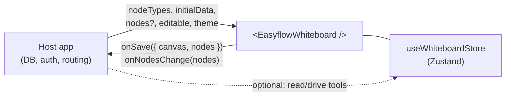
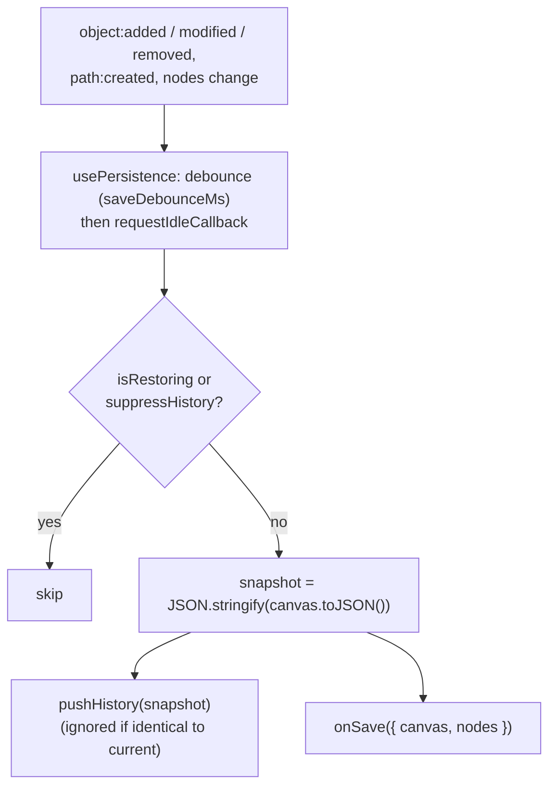

# Architecture

How `easyflow-whiteboard` is put together: the layers it renders, where
state lives, how input is routed, and how data flows from a pointer event to a
saved board.

Companion docs:
- [README.md](./README.md): API and usage
- [CONNECTORS.md](./CONNECTORS.md): connector internals in depth
- [EDITABLE_MODE.md](./EDITABLE_MODE.md): read-only mode
- [TESTING_REPORT.md](./TESTING_REPORT.md): QA coverage and fixes

---

## Contents

1. [Overview](#1-overview)
2. [Tech stack and build](#2-tech-stack-and-build)
3. [Public API](#3-public-api)
4. [Rendering layers](#4-rendering-layers)
5. [Component tree](#5-component-tree)
6. [State model](#6-state-model)
7. [Coordinate systems](#7-coordinate-systems)
8. [Input routing](#8-input-routing)
9. [Core flows](#9-core-flows)
10. [Hooks catalogue](#10-hooks-catalogue)
11. [Custom Fabric classes](#11-custom-fabric-classes)
12. [Styling](#12-styling)
13. [Performance patterns](#13-performance-patterns)
14. [Extending the whiteboard](#14-extending-the-whiteboard)
15. [Constraints and known debt](#15-constraints-and-known-debt)

---

## 1. Overview

The whiteboard is a single React component, `<EasyflowWhiteboard />`, that
combines two very different kinds of content on one infinite, zoomable canvas:

| Content | Rendered by | Examples |
|---|---|---|
| **Vector objects** | Fabric.js on a `<canvas>` | Rectangles, circles, frames, lines, arrows, pen strokes, text, images, connectors |
| **HTML nodes** | React, as absolutely positioned HTML | Any component the host registers in `nodeTypes` |

Both share one **world (scene) coordinate system**. The HTML layer is
transformed with the same viewport matrix as the Fabric canvas, so a node at
`(x: 100, y: 200)` sits exactly over canvas point `(100, 200)` at any zoom or
pan.

The library owns the UI and interaction; the host app owns the data. The host
passes `initialData` in and receives a debounced `onSave(payload)` out.



---

## 2. Tech stack and build

| Concern | Choice |
|---|---|
| Canvas engine | Fabric.js **v7** (peer dependency) |
| UI | React 18/19 (peer), `"use client"` components |
| Global state | Zustand v5 (peer) |
| Styling | Tailwind CSS v4, compiled to `dist/styles.css` and scoped under `.easyflow-whiteboard` |
| Icons | lucide-react (the only runtime dependency; no UI primitive library) |
| Language | TypeScript (strict), `moduleResolution: bundler` |

**Build** (`npm run build`):
- `tsc` compiles `src/` to `dist/`, with extensionless ESM imports and `.d.ts`
  files. This targets bundlers such as Next.js, Vite and webpack.
- The Tailwind CLI compiles `src/styles.css` to `dist/styles.css`, which
  consumers import once.

**Release:** `npm run release:patch|minor|major` builds, bumps the version and
publishes.

---

## 3. Public API

Everything is exported from `src/index.ts`:

| Export | Kind | Purpose |
|---|---|---|
| `EasyflowWhiteboard` | Component | The whole editor (implemented in `components/whiteboard/whiteboard.tsx`), with a `ref` exposing `WhiteboardHandle` |
| `useWhiteboardStore` | Zustand hook | Read or drive tools, tool options, zoom, undo state, `editable` |
| `WhiteboardInitialData` | Type | `{ canvas?: string; nodes? }`, what you load |
| `WhiteboardSavePayload` | Type | `{ canvas: string; nodes }`, what `onSave` receives |
| `WhiteboardNode`, `NodeProps`, `NodeTypeDefinition`, `NodeTypes`, `AddNodeInput`, `WhiteboardHandle` | Types | Custom node contract and ref API |

**Component props:** `initialData`, `onSave`, `saveDebounceMs` (2000),
`nodeTypes`, `nodes` + `onNodesChange` (optional controlled mode), `isLoadingData`,
`editable` (true), `showMinimap` (true), `theme` ("dark" | "light" | "system").

**Persisted format:**
- `canvas` is `JSON.stringify(canvas.toJSON())`: standard Fabric JSON plus the
  custom types `frame`, `arrow`, `bidirectional-arrow` and `connector`.
- Every object carries an `id`. Connectors reference shapes and nodes by `id`.
- Nodes are saved separately as one `nodes` array (`{ id, type, x, y, data }`) in world
  coordinates.

---

## 4. Rendering layers

The root container stacks six layers. Each one exists for a specific reason:

```
 z   Layer                         Element / owner                         Pointer events
───  ────────────────────────────  ──────────────────────────────────────  ───────────────
100  UI chrome                     toolbar · properties panel · zoom pill   yes (per widget)
                                   · minimap                               
 60  Connector layer               <canvas aria-hidden> (useConnectors)     none
 50  Node overlay                  CanvasOverlayLayer (custom nodes)        nodes only, and only
                                                                            with the Select tool
  1  Fabric canvas                 lower canvas (objects) +                 yes
                                   upper canvas (selection, input)
  0  Dot grid                      CSS radial-gradient background           none
```

- **Dot grid:** a CSS radial-gradient background.
  - Why: it's cheap, and Fabric never has to redraw it.
- **Fabric canvas:** holds every vector object. Its upper canvas receives
  input for drawing, selection and panning.
  - Why: vector editing, transforms, hit testing and JSON serialization come
    for free.
- **Node overlay:** a `<div>` transformed by
  `translate(vpt.x, vpt.y) scale(zoom)` and updated on Fabric `after:render`.
  - Why: nodes are arbitrary, interactive React UI (forms, buttons, expanding
    previews) that would be impractical to draw on a canvas.
- **Connector layer:** a transparent, retina-sized canvas repainted after every
  main render. It draws connectors, anchor dots and drop highlights.
  - Why: connectors must stay visible where they cross nodes, which are HTML
    above the Fabric canvas. See
    [CONNECTORS.md → Rendering](./CONNECTORS.md#rendering-the-connector-layer).
- **UI chrome:** the toolbar is fixed at the bottom centre, the properties
  panel on the left, the zoom pill top-right and the minimap bottom-right.
  - Why: these are screen-space controls that never scale with the canvas.

Nothing is portalled: the Insert menu renders inside the toolbar container
(outside its horizontal scroller so it isn't clipped), so every element
inherits the scoped styles and theme variables.

---

## 5. Component tree

```
EasyflowWhiteboard (whiteboard.tsx)               ← composes all canvas hooks
├─ <div class="easyflow-whiteboard">               ← CSS scope root
│  └─ <div ref=containerRef>                        ← "board": positioning context for all layers
│     ├─ dot grid <div>
│     ├─ <canvas ref=canvasRef>                     ← Fabric wraps it in .canvas-container
│     ├─ MemoizedOverlayWrapper                     ← re-renders only on nodes/selection changes
│     │  └─ CanvasOverlayLayer
│     │     └─ NodeItem ×n  → nodeTypes[type].component  (memoized per node)
│     ├─ [connector layer <canvas>]                 ← inserted imperatively by useConnectors
│     └─ UI layer (z 100)
│        ├─ MemoizedToolbarWrapper → WhiteboardToolbar | ToolbarSkeleton
│        │  ├─ ToolButton ×n
│        │  ├─ InsertMenuButton / InsertMenuPanel  (types with a `label`)
│        ├─ ToolOptionsPanel
│        │  └─ PenOptions | ShapeOptions | TextOptions | ImageOptions |
│        │     LineOptions | ArrowOptions | ConnectorOptions, + LayerControls
│        ├─ ZoomControls
│        └─ Minimap                                 (when showMinimap)
```

The two memoized wrappers are deliberate. Pan and zoom fire `after:render` at
display rate, and without the wrappers every frame would re-render the toolbar
and every node.

---

## 6. State model

State is split by how often it changes and who needs to read it:

| Where | What | Why there |
|---|---|---|
| **Fabric canvas** (imperative) | Every vector object, the viewport transform, the active selection | Fabric's own model is the source of truth for the scene. Mirroring it into React would re-render at pointer rate |
| **Zustand store** `useWhiteboardStore` | `activeTool`, `toolOptions` (per tool, including `connector`), `selectedObjectType`, `editable`, undo/redo `history` + `historyIndex`, `zoom`, `theme`, layer-order actions | Shared by the toolbar, panels and many hooks without prop drilling; hooks read it via `getState()` inside event handlers |
| **React state** (root) | `nodes` (unless controlled by the `nodes` prop), `canvasReady`, `selectionBox`, `selectedCanvasObjects`, the zoom value shown in the pill | Drives React rendering of nodes and chrome |
| **React state** (overlay) | A local copy of the nodes during drags, the `selectedIds` of nodes | Nodes move every frame during a drag; local state keeps that inside the overlay |
| **Refs** | `isRestoringRef`, `suppressHistoryRef`, `isDrawingRef`, drawing/eraser scratch refs, props mirrored into refs | Flags and latest values that event handlers need without re-registering listeners |
| **Module registries** (`WeakMap` per canvas) | Node rectangles (`setNodeRects`), "has connector layer" | Lets Fabric-side code (connectors, minimap) see HTML nodes without React coupling |

**Two flags** coordinate history and saving:
- `isRestoringRef` is `true` while the canvas reloads from JSON (hydration,
  undo/redo). Cascade-deletes and autosave history pushes are skipped during
  that window.
- `suppressHistoryRef` is `true` during a multi-step gesture (drawing a shape,
  erasing, dragging a connector). The gesture pushes exactly one snapshot when
  it commits.

---

## 7. Coordinate systems

| System | Units | Used by |
|---|---|---|
| **Scene / world** | Canvas units, independent of zoom | Fabric object geometry, node `x/y`, connector ends, minimap maths, saved data |
| **Viewport** | CSS px relative to the canvas element | Fabric controls, the connector layer overlay (dots, outlines), hit radii |
| **Client** | CSS px relative to the page | DOM pointer events |

Conversions:

```
viewport = scene × zoom + (vpt[4], vpt[5])      // vpt = canvas.viewportTransform
scene    = canvas.getScenePoint(domEvent)        // client → scene
```

Screen-constant UI, such as anchor dots 18px outside an edge or a 10px hit
radius, is computed in viewport px and converted with `/ zoom`, so it feels the
same at every zoom level.

---

## 8. Input routing

Several systems listen to the same pointer. Each gesture has exactly one owner:

| Input | Owner | Notes |
|---|---|---|
| Pointer-down on an anchor dot or a selected connector's endpoint, or anywhere with the **Connector tool** | `useConnectors`, via a **window capture** listener | Runs before Fabric and the React node handlers. It stops the event and swallows the matching `mousedown`, `touchstart` and `click`. It is limited to this board's canvas and nodes, and yields to Fabric's resize/rotate handles |
| Pointer on the canvas: drawing, selecting, moving, rubber band, pan, eraser | **Fabric**, through `useMouseHandlers` (rAF-throttled router), `usePan`, `useSelection`, `useEraser` | Fabric runs with `enablePointerEvents: false`, so it uses mouse and touch events |
| Pointer on a node (Select tool only) | Node React handlers → `useNodeDrag` / `useNodeSelection` | Under any other tool, nodes are `pointer-events: none`, so the canvas receives the input |
| Pointer on the minimap | `Minimap` (pointer capture) | Outside the board element, so board handlers ignore it |
| Wheel on the canvas | `useZoom` (`mouse:wheel`): Ctrl/⌘ + scroll zooms at the cursor, plain scroll pans vertically, Shift + scroll pans horizontally | Also blocks the browser's own Ctrl+wheel zoom |
| Wheel on a node | `useWheelZoom` forwards it into Fabric | Keeps zoom and pan working over nodes |
| Keys: tool letters, Delete, Ctrl+Z/Y | `WhiteboardToolbar` | Ignored while typing in inputs, textareas or Fabric's text editor |
| Keys: Ctrl + `=` / `-` / `0` | `useZoom` | |
| Keys: Ctrl+C / Ctrl+V | `useCopyPaste` | Paste is disabled in read-only mode |
| Keys: Ctrl+A, Escape, Delete on nodes | `useKeyboardShortcuts` (overlay) | |
| Escape during a connector drag | `useConnectors` | Cancels the gesture |

**Hit testing:**
- Fabric uses bounding boxes by default.
- Connectors override this with a route-distance test. The hook wraps the
  canvas instance's `_checkTarget` for this and restores it on unmount.
- Connectors also opt out of rubber-band selection.

---

## 9. Core flows

### 9.1 Mount and hydration

```mermaid
sequenceDiagram
  participant R as React
  participant CI as useCanvasInit
  participant F as Fabric
  participant P as usePersistence
  R->>CI: mount
  CI->>F: new Canvas(el), initializeFabricCanvas()
  Note over CI: double requestAnimationFrame (Fabric context attached)
  alt initialData has canvas JSON and/or nodes
    CI->>CI: isRestoringRef = true
    CI->>F: loadFromJSON(initialData.canvas) (if present)
    CI->>P: pushHistory(snapshot)
    CI->>R: onNodesLoaded(initialData.nodes) (if present, uncontrolled only)
    CI->>CI: isRestoringRef = false
  else nothing to load
    CI->>F: addWelcomeContent() (logo + title; fades out on first tool use)
    CI->>P: pushHistory(snapshot)
  end
  CI->>R: onReady → canvasReady = true
  R->>R: toolbar replaces skeleton, overlay and minimap sync
```

Hooks that need the Fabric instance register their listeners in effects that
run after `useCanvasInit`'s effect (hook order in `whiteboard.tsx`), so
`fabricCanvasRef.current` is already set.

### 9.2 Drawing a shape

1. The tool button or shortcut calls `setActiveTool("rectangle")`.
2. `useToolManager` makes objects non-selectable and sets the crosshair
   cursor.
3. `mouse:down` → `useDrawing` creates the shape (`suppressHistoryRef = true`).
4. `mouse:move` (rAF-throttled by `useMouseHandlers`) → `updateDrawingObject`.
5. `mouse:up`:
   - The shape becomes selectable. Frames are sent to the back.
   - One history snapshot is pushed.
   - The tool returns to `select`.
6. `object:added` → `usePersistence` schedules a debounced save. Its history
   push is deduplicated, because the snapshot is identical.

### 9.3 Selection and the properties panel

- **Canvas selection:** `selection:created/updated` → `useSelection` maps the
  object to a tool type (`rectangle`, `connector`, …) and sets
  `selectedObjectType`, loading the object's style into `toolOptions`.
  `ToolOptionsPanel` shows the matching options.
- **Editing a style:** panel edits call `setToolOption`. `useLiveUpdate` and
  `useTextStyle` apply the new options to the selected objects. Connectors are
  re-routed, because their width and line type affect geometry.
- **Rubber band across both layers:** `useSelection` tracks an invisible
  `Rect` and publishes `selectionBox`, and the overlay's `useSelectionBox`
  hit-tests nodes against it. Guard refs in `useNodeSelection` stop the Fabric
  selection and the node selection from clearing each other.
- **Moving a mixed selection:**
  - Dragging co-selected Fabric objects moves the nodes via `useFabricSync`
    (deltas accumulated per frame).
  - Dragging a node moves co-selected Fabric objects via `useNodeDrag`.

### 9.4 Saving and undo/redo



**Undo/redo:**
1. The toolbar calls `undo()`/`redo()` on the store, which moves
   `historyIndex` (capped at 50 entries).
2. `restoreCanvas` then runs:
   - `isRestoringRef = true`
   - `loadFromJSON`
   - `replaceCurrentHistory(freshSnapshot)`
3. That last step matters because a reloaded canvas re-serializes slightly
   differently. Storing the fresh form means the autosave that follows the
   restore is recognised as "no change" and doesn't wipe the redo stack.

Node positions are **not** in canvas history. See
[Constraints](#15-constraints-and-known-debt).

### 9.5 Connectors (summary)

- **Ends:** a connector's ends reference a shape or node `id` and resolve
  through one `ConnectTarget` interface (Fabric object or node rectangle).
- **Re-routing** happens in three places:
  - on Fabric transform events, for shapes
  - in `useNodeConnectorSync`, for nodes
  - after loading from JSON
- **Deleting** a shape or node also removes its connectors.
- **Rendering:** connectors are painted on the connector layer.

The full design is in [CONNECTORS.md](./CONNECTORS.md).

### 9.6 Read-only mode

1. The `editable` prop is synced into the store.
2. `useToolManager` makes every object non-selectable and non-evented, and
   forces the tool to `select`.
3. Every mutating path checks `editable` and does nothing when it's false:
   drawing, delete, paste, node drag, adding nodes, and connector gestures.
4. Pan, zoom and the minimap keep working, because they only navigate.
5. Nothing mutates, so `onSave` never fires.

### 9.7 Minimap

The minimap redraws after every main-canvas render, at most once per frame.
- **What it draws:** object bounds, connector routes, node rectangles (from the
  registry) and the visible viewport, all in one fitted scene-to-map mapping.
- **Navigation:** it calls `setViewportTransform`. The mapping is frozen during
  a drag so the map doesn't rescale under the pointer.

---

## 10. Hooks catalogue

**Canvas hooks** (`src/hooks/`), composed by the root component in this order:

| Hook | Responsibility | Listens to |
|---|---|---|
| `useCanvasInit` | Create Fabric canvas, hydrate `initialData`, welcome content, resize | window `resize`, canvas touch |
| `usePersistence` | Debounced save → `pushHistory` + `onSave` | `object:*`, `path:created`, nodes |
| `useToolManager` | Per-tool canvas mode: drawing mode, selectability, cursors; read-only lockdown | `activeTool`, `toolOptions`, `editable` |
| `useDrawing` | Drag-to-create rect, circle, frame, line, arrow; place text | via `useMouseHandlers` |
| `useCopyPaste` | Ctrl+C/V with id remapping and connectors between copies | window `keydown` |
| `useEraser` | Eraser brush trail and deleting intersected objects | via `useMouseHandlers` |
| `useZoom` | Wheel zoom/pan, Ctrl± shortcuts, blocks browser zoom | `mouse:wheel`, window `wheel` / `keydown` |
| `usePan` | Hand-tool drag, two-finger pinch | `mouse:*` |
| `useConnectors` | Connector gestures, hover, connector layer, follow/cascade, route hit testing | window capture pointer events, `object:*`, `selection:*`, `after:render` |
| `useSelection` | Selection → store and panel; rubber-band box for nodes | `selection:*`, `mouse:*` |
| `useTextStyle` / `useLiveUpdate` | Apply tool options to selected objects | `toolOptions` |
| `useMouseHandlers` | Single router for drawing and eraser handlers, rAF-throttled `mouse:move` | `mouse:*` |

`useConnectors` is deliberately registered **before** `useSelection`, so
connectors are removed from multi-selections before the selection reaches the
store.

**Overlay hooks** (`src/components/node/hooks/`):

| Hook | Responsibility |
|---|---|
| `useNodeState` | Local node state mirrored from props, plus refs |
| `useNodeSelection` | `selectedIds` and the guard refs that coordinate with Fabric selection |
| `useNodeDrag` | Node drag lifecycle (rAF), moving co-selected Fabric objects |
| `useFabricSync` | Fabric drags → co-selected node movement (delta accumulator) |
| `useWheelZoom` | Forward wheel events from nodes into Fabric |
| `useSelectionBox` | Hit-test nodes against the rubber-band box |
| `useKeyboardShortcuts` | Ctrl+A, Escape, Delete for nodes |
| `useNodeConnectorSync` | Publish node rectangles (with minimap colour) to the registry; expose measured sizes; re-route connectors; remove connectors of deleted nodes |

---

## 11. Custom Fabric classes

All in `src/lib/` and registered with `classRegistry`, so `loadFromJSON` can
revive them:

| Class | `type` | Notes |
|---|---|---|
| `Frame` | `frame` | `Rect` subclass: white, light border, soft shadow, always sent to the back |
| `Arrow` | `arrow` | `Line` subclass with a filled head at the end |
| `BidirectionalArrow` | `bidirectional-arrow` | Heads at both ends |
| `Connector` | `connector` | `FabricObject` subclass bound to targets by id. Elbow/curved/straight routing, route-based hit testing, painted on the connector layer. See [CONNECTORS.md](./CONNECTORS.md) |

Every object also serializes an `id`: `id` is added to
`FabricObject.customProperties`, and `object:added` assigns a UUID when an
object doesn't have one.

---

## 12. Styling

- **Scoping:**
  - All styles live under `.easyflow-whiteboard`. Tailwind is compiled with
    `theme` and `utilities` only; preflight is deliberately omitted so the
    host page isn't reset.
  - A small reset (box-sizing, borders, button and input defaults) sits in the
    `base` layer, wrapped in `:where()`. That gives it zero specificity and a
    layer below utilities. It covers the whiteboard and its portalled
    menus, so the UI looks right in hosts with or without Tailwind.
- **Design tokens:**
  - Canvas-drawn UI can't read CSS variables, so the EasyFlow design-system
    values (surfaces, text, Primary Blue `#0D8EFF`, brand accents, radius)
    live in `src/lib/design-tokens.ts`.
  - The connector palette, the default connector colour, the handles and the
    minimap all read from there.
- **Themes:**
  - The root carries `data-theme="dark" | "light"` (from the `theme` prop;
    "system" is resolved with `matchMedia`). The resolved value is also in the
    store for canvas-drawn UI (anchor dots, welcome text).
  - Chrome colours are CSS variables (`--wb-bg`, `--wb-surface`, `--wb-panel`…)
    in `styles.css`. Dark values are the original design.
  - Light mode mirrors Tailwind's neutral/gray scales and `--color-white` under
    `[data-theme="light"]`, so components need no per-theme classes.
  - Default tool colours are the theme's ink (`INK` in `design-tokens.ts`) and
    follow theme changes unless the user picked another colour.
- **Fonts:** fonts are inherited from the host (Red Hat Display in EasyFlow);
  the library bundles none.

---

## 13. Performance patterns

| Pattern | Where | Why |
|---|---|---|
| `requestRenderAll()` rather than `renderAll()` | Most hooks | Coalesces paints into Fabric's rAF loop |
| rAF throttle on pointer moves | `useMouseHandlers`, `useNodeDrag`, `useFabricSync`, minimap | Pointer events can arrive at 200–1000 Hz |
| Props mirrored into refs; listeners registered once | Canvas hooks | No teardown/re-attach of Fabric listeners on each render |
| `React.memo` with custom comparators | Toolbar and overlay wrappers, panels | Pan and zoom don't re-render chrome or nodes |
| Delta accumulator | `useFabricSync` | No lost movement when a frame is skipped |
| Debounce + `requestIdleCallback` | `usePersistence` | `toJSON()` on big boards runs when the browser is idle |
| History cap (50) and dedupe | Store | Snapshots can be 100 KB+; duplicates would waste memory and break redo |
| One lookup snapshot per re-route pass | `refreshConnectors` | O(objects + connectors) per move event |
| Layout effect for node → connector sync | `useNodeConnectorSync` | Connectors move in the same frame as the node |
| `objectCaching: false` only where geometry is dynamic | `Connector` | Every other object keeps Fabric's cached bitmaps |

---

## 14. Extending the whiteboard

**Add a drawing tool:**
1. Add the id to `Tool` and any options to `ToolOptions` and
   `defaultToolOptions` in the store.
2. Add a button and shortcut in `whiteboard-toolbar.tsx` (`TOOLS` and the
   shortcut map). Adjust the separator indices if needed.
3. Add a `case` in `useToolManager` for its canvas mode.
4. Create the object in `useDrawing`, or in a dedicated hook routed through
   `useMouseHandlers`.
5. Map its `type` in `useSelection`'s type map, add an options component, and
   wire it into `ToolOptionsPanel`.
6. If it's a custom class, register it with `classRegistry`, and strip `type`
   in `fromObject`.

**Add a new node type (host side):** no library change is needed. Register a
component in the `nodeTypes` prop. The overlay wraps it with drag, selection,
stacking, connector publishing and minimap colour automatically.

**Make something connectable:**
- Fabric objects are connectable by default, unless `isConnectable` in
  `fabric-connector.ts` excludes them.
- Anything else needs to be exposed as a `ConnectTarget` (an `id`,
  `center()`, and `anchor(side)`) through the lookup in `createTargetLookup`.

**Re-theme:** edit `src/lib/design-tokens.ts` for canvas-drawn UI, and the
Tailwind classes in components for the HTML UI.

---

## 15. Constraints and known debt

| Item | Impact | Suggested direction |
|---|---|---|
| Node positions aren't in undo history | Undo restores canvas objects only | Add nodes to history snapshots |
| Some hooks receive unused placeholder args (`canvasZoom: 1`, `setCanvasViewport: () => {}`) | Noise | Remove the leftover parameters |
| `usePan` and `useZoom` mutate `viewportTransform` in place | Works (verified), but bypasses `setViewportTransform` bookkeeping | Route through `setViewportTransform` |
| Connector routing has no obstacle avoidance | Lines may cross other shapes and nodes | Grid/A* router behind `elbowRoute` |
| The parent Next.js app keeps its own copies of these components under `app/components` | Changes must be made twice, or the copies drift | Consume the package (or a workspace link) instead of copies |
| The browser e2e harness lives outside the repo | Regressions aren't caught in CI | Add `e2e/` with puppeteer and `npm run test:e2e` |
